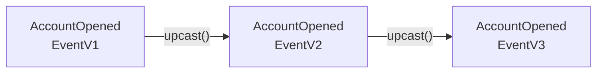

## Introduction

**Domain events** are one of the primary modeling constructs in an event-sourced system. To quote Eric Evans:

> A domain event is a full-fledged part of the domain model, a representation of something that happened in the domain. Ignore irrelevant domain activity while making explicit the events that the domain experts want to track or be notified of, or which are associated with state changes in the other model objects.
>
> <cite>Eric Evans (2004) Domain driven design: Tackling complexity in the heart of software. Addison-Wesley</cite>

Domain events represent facts: they are immutable records of something that has happened within the domain. Each event is associated with an [aggregate](./aggregates.md) and often implies a change in the aggregate’s state. Together, the set of events for an aggregate defines both its behavior and history.

:::note
**What about integration events?**

In traditional DDD, a distinction is often made between domain events (used internally within a bounded context) and integration events (used to communicate across contexts or services). DugongJS does not enforce this separation. All events—whether used internally or shared externally—are treated uniformly as domain events.
:::

## Sharing Domain Events Across Services

In a typical microservice architecture, domain events are often published to a message broker to enable asynchronous inter-process communication. This is useful for:

- State synchronization across services (event-carried state transfer).
- Business process coordination, where services react to changes in others.
- Data replication or export to external systems (e.g. read model generation).

Because events may need to be consumed by multiple services, it is beneficial for event definitions to be easily shared.

One effective approach is to manage your microservices in a monorepo and organize code by bounded context. Within each context, you can define reusable packages for your domain events. Other services that depend on these events can import them directly from the owning context’s package, preserving consistency and avoiding duplication.

Here is an example folder structure:

```json title="monorepo"
└─ 📁 iam-context
│  └- 📁 packages
│  │  └- 📁 domain-events
│  └- 📁 services
│  │  └- 📁 authorization-service
│  │  └- 📁 user-service
└─ 📁 banking-context
│  └- 📁 packages
│  │  └- 📁 domain-events
│  └- 📁 services
│  │  └- 📁 account-service
│  │  └- 📁 payment-service

```

In this example, the `services` folders contain microservices managed within a bounded context, and the `packages` folders contain the sharable libraries that represent the _published language_ of each bounded context. If the `account-service` in the banking context needs to integrate with the `user-service` in the IAM (Identity & Access Management) context, it can simply install the domain events package maintained by that context and import its domain event definitions.

:::tip
[Turborepo](https://turborepo.com/) and [Nx](https://nx.dev/) are good modern alternatives for managing monorepos.
:::

If you do not use microservices or only have a single microservice to get started with, you can keep domain event definitions within your project and migrate to a monorepo structure later.

## Defining Domain Events

DugongJS provides the `AbstractDomainEvent` base class for creating domain events. Classes that derive from `AbstractDomainEvent` must define four constant properties:

- `origin`
- `aggregateType`
- `type`
- `version`

Together, these four constant properties uniquely identify a domain event. Let's explore these in turn.

### Origin

The `origin` is a label that identifies the service responsible for managing the domain events for the aggregate. For more details, see the documentation for [origin](./origin.md).

You might wonder why the origin is defined directly on the domain event class, rather than configured centrally or injected at runtime. As mentioned above, domain events are often shared across multiple services, and the event definitions may not reside in the same project that manages their lifecycle. Embedding the origin in the class ensures that the event always carries its identity, regardless of where it’s used.

### Aggregate Type

The `aggregateType` is a label that identifies the aggregate to which the event belongs. Together, the `aggregateType` and `origin` uniquely identify the aggregate and its associated domain events within the system.

### Version

The `version` property specifies the version of the event schema. As your application evolves, you may need to introduce breaking changes to events. By versioning events appropriately, you can manage these changes without disrupting consumers. See [Upcasting](#upcasting) for how to replay events that were stored at an older version.

### Type

The `type` is a label that describes the event type. It is typically defined on each concrete event class.

### Creating an Abstract Base Class

It's generally a good idea to begin by defining a base class for the domain events of a particular aggregate type. In the following example, we define the domain events for a `BankAccount` aggregate by first creating an abstract base class:

```typescript
abstract class AbstractBankAccountDomainEvent<
    TPayload extends DomainEventPayload | null = null
> extends AbstractDomainEvent<TPayload> {
    public readonly origin = "BankingContext-AccountService";
    public readonly aggregateType = "BankAccount";
    public readonly version = 1;
}
```

The `origin`, `aggregateType`, and `version` are defined in the abstract base class, but the `type` is left to be defined in the derived classes. The `version` is set to 1 by default, and can be overridden in concrete subclasses if breaking changes are introduced later.

The generic type parameter `TPayload` defines the shape of the domain event’s payload, enabling type safety. A domain event may also have a `null` payload, which is a good default to use.

### Defining Concrete Domain Events

We can now define the concrete domain events for the `BankAccount` aggregate by extending the base class:

```typescript
@DomainEvent()
export class AccountOpenedEvent extends AbstractBankAccountDomainEvent<{ owner: string; initialBalance: number }> {
    public readonly type = "AccountOpened";
}

@DomainEvent()
export class AccountClosedEvent extends AbstractBankAccountDomainEvent {
    public readonly type = "AccountClosed";
}

@DomainEvent()
export class MoneyDepositedEvent extends AbstractBankAccountDomainEvent<{ amount: number }> {
    public readonly type = "MoneyDeposited";
}

@DomainEvent()
export class MoneyWithdrawnEvent extends AbstractBankAccountDomainEvent<{ amount: number }> {
    public readonly type = "MoneyWithdrawn";
}
```

:::tip
The `@DomainEvent()` decorator is imported from `@dugongjs/core`.
:::

In this example, `AccountOpenedEvent`, `MoneyDepositedEvent`, and `MoneyWithdrawnEvent` each have a payload, while `AccountClosedEvent` does not.

Each concrete domain event must be decorated with the `@DomainEvent()` decorator. This is necessary to register the event in a global registry used for serialization and deserialization. Without it, the system won’t be able to resolve the correct class when rehydrating events from storage. Be sure to include it on every domain event!

## Working With Domain Events

### Construction

In general, domain events should be created by aggregates as part of their business logic — not constructed directly. However, direct instantiation can be useful in testing scenarios.

The constructor signature for a domain event depends on whether it includes a payload:

- Domain events without a payload require a single parameter: the **aggregate ID**.
- Domain events with a payload require two parameters: the **aggregate ID** and the **payload**.

Here’s an example:

```typescript
const accountId = "<account-id>";

const accountOpenedEvent = new AccountOpenedEvent(accountId, {
    owner: "Bob",
    initialBalance: 100
});

const accountClosedEvent = new AccountClosedEvent(accountId);
```

### Properties

Domain events expose a variety of properties. In normal usage, these are managed automatically by DugongJS and **should not be set manually**. In many cases, manually setting these values will have no effect or may be overridden internally.

The following table lists the available getters that you can call on a domain event instance to extract information about it:

| Method                    | Description                                                                                                                          | Return type                       |
| ------------------------- | ------------------------------------------------------------------------------------------------------------------------------------ | --------------------------------- |
| `getOrigin()`             | Returns the origin of the domain event.                                                                                              | `string`                          |
| `getAggregateType()`      | Returns the aggregate type of the domain event.                                                                                      | `string`                          |
| `getType()`               | Returns the type of the domain event.                                                                                                | `string`                          |
| `getVersion()`            | Returns the version of the domain event.                                                                                             | `number`                          |
| `getId()`                 | Returns the ID of the domain event. The ID is a UUID (v4).                                                                           | `string`                          |
| `getAggregateId()`        | Returns the aggregate ID associated with the domain event.                                                                           | `string`                          |
| `getPayload()`            | Returns the payload of the domain event.                                                                                             | `TPayload`                        |
| `getSequenceNumber()`     | Returns the sequence number of the domain event. The first event for an aggregate instance starts at 1 and increments automatically. | `number`                          |
| `getTimestamp()`          | Returns the timestamp indicating when the domain event was created.                                                                  | `Date`                            |
| `getTenantId()`           | Returns the tenant ID associated with the domain event. This is an optional, user-defined field for multi-tenant applications.       | `string \| undefined`             |
| `getCorrelationId()`      | Returns the correlation ID of the domain event. This is an optional, user-defined field for tracking cross-event flows.              | `string \| undefined`             |
| `getTriggeredByEventId()` | Returns the ID of the domain event that triggered the creation of the current event. This is an optional, user-defined field.        | `string \| undefined`             |
| `getTriggeredByUserId()`  | Returns the ID of the user who triggered the creation of the current event. This is an optional, user-defined field.                 | `string \| undefined`             |
| `getMetadata()`           | Returns metadata associated with the domain event. This must be a serializable object and can be used to store auxiliary data.       | `SerializableObject \| undefined` |

All non-constant properties also have corresponding **setter methods**, which can be used in testing or when manually constructing domain events outside the normal aggregate flow.

## Lifecycle Hooks

You can define lifecycle hooks for domain events by implementing any of the following methods:

- `onCreate(): void`: Called when a domain event is created by an aggregate.
- `onStage(): void`: Called when a domain event is staged by an aggregate.
- `onCommit(): void`: Called when a domain event is committed to the event log.
- `onApply(): void`: Called when a domain event is applied to an aggregate.
- `upcast(): AbstractDomainEvent`: Called when a domain event is deserialized, and must return the event at its next version. See [Upcasting](#upcasting).

These hooks can be useful for tasks like payload validation or logging.

### Domain Event Payload Validation

A common use case for lifecycle hooks is payload validation — for example, ensuring that payloads conform to a JSON Schema or another type-safe structure such as Protocol Buffers. In the previous example, `AbstractBankAccountDomainEvent` could be refactored to use Zod for schema validation like so:

```typescript
import { z } from "zod";

abstract class AbstractBankAccountDomainEvent<
    TPayload extends DomainEventPayload | null = null
> extends AbstractDomainEvent<TPayload> {
    public readonly origin = "BankingContext-AccountService";
    public readonly aggregateType = "BankAccount";
    public readonly version = 1;

    protected validatePayload(payloadSchema: z.ZodType<TPayload>): void {
        const validationResult = payloadSchema.safeParse(this.payload);

        if (!validationResult.success) {
            throw new Error(`Invalid payload: ${validationResult.error}`);
        }
    }
}
```

We can then define a payload schema for the `AccountOpenedEvent` like this:

```typescript
const AccountOpenedPayloadSchema = z.object({
    owner: z.string().min(1).max(100),
    initialBalance: z.number().positive().finite()
});

type AccountOpenedPayload = z.infer<typeof AccountOpenedPayloadSchema>;

@DomainEvent()
export class AccountOpenedEvent extends AbstractBankAccountDomainEvent<AccountOpenedPayload> {
    public readonly type = "AccountOpened";

    public onCreate(): void {
        this.validatePayload(AccountOpenedPayloadSchema);
    }
}
```

:::note
**Why not validate the payload in the constructor?**

Validating the payload in the constructor is generally discouraged. Throwing an error during construction can prevent existing events from being properly deserialized if the schema has changed since the event was created. In a microservice architecture, not all services may have the latest schema at runtime. It’s safer to perform validation only during event creation, using the `onCreate()` lifecycle hook.

You could perform the same validation in the `onApply()` lifecycle hook to detect potential issues during event replay — but in that case, it’s often better to log a warning rather than throw an error.
:::

While payload validation is useful for enforcing structure and assumptions, it is not the place to enforce invariants or business rules. Those concerns belong in the aggregate. Likewise, this validation should not replace user input validation, which is best handled in the application layer.

### Standard Schema validation (New)

DugongJS now supports [Standard Schema](https://standardschema.dev/)! By using Standard Schema, any Standard Schema-compliant library can be used, with payload validation and transformation automatically handled by DugongJS. To create a domain event using a schema, use the static `fromSchema` method on `AbstractDomainEvent`:

```typescript
import { DomainEvent, AbstractDomainEvent } from "@dugongjs/core";
import { z } from "zod";

const schema = z.object({
    owner: z.string().min(1).max(100),
    initialBalance: z.number().positive().finite()
});

@DomainEvent()
export class AccountOpenedEvent extends AbstractDomainEvent.fromSchema(schema) {
    public readonly origin = "BankingContext-AccountService";
    public readonly aggregateType = "BankAccount";
    public readonly type = "AccountOpened";
    public readonly version = 1;
}
```

This has two main advantages:

1. It eliminates the need to manually set up type inference from the schema and implement `onCreate()`, reducing the amount of boilerplate.
2. Since Standard Schema also supports data transformation, you can encode complex data types and their serialization directly into the schema.

To illustrate the second point, consider adding something like a `Date` object to the payload. Since the payload must be a serializable object, we cannot pass a Date object directly. The best we can do is represent it using something like an ISO string or epoch time, as shown below:

```typescript
const schema = z.object({
    owner: z.string().min(1).max(100),
    initialBalance: z.number().positive().finite(),
    openedAt: z.iso.datetime(),
    validUntil: z.iso.datetime().optional()
});

@DomainEvent()
export class AccountOpenedEvent extends AbstractDomainEvent.fromSchema(schema) {
    public readonly origin = "BankingContext-AccountService";
    public readonly aggregateType = "BankAccount";
    public readonly type = "AccountOpened";
    public readonly version = 1;
}
```

However, it introduces a mismatch between the type used by the [Aggregate](aggregates.md), which likely operates on `Date` objects, and the format required by the payload. With Standard Schema, we can define both an input and output format and allow the validation layer to handle the transformation:

```typescript
const dateToIsoDatetime = z.codec(z.date(), z.iso.datetime(), {
    decode: (isoString) => new Date(isoString),
    encode: (date) => date.toISOString()
});

const schema = z.object({
    owner: z.string().min(1).max(100),
    initialBalance: z.number().positive().finite(),
    openedAt: dateToIsoDatetime,
    validUntil: dateToIsoDatetime.optional()
});

@DomainEvent()
export class AccountOpenedEvent extends AbstractDomainEvent.fromSchema(schema) {
    public readonly origin = "BankingContext-AccountService";
    public readonly aggregateType = "BankAccount";
    public readonly type = "AccountOpened";
    public readonly version = 1;
}
```

Now, when creating an `AccountOpenedEvent`, we can use `Date` objects directly in the payload, and the schema will handle the transformation to and from ISO strings during serialization and deserialization:

```typescript
@Aggregate("BankAccount")
export class BankAccount extends AbstractAggregateRoot {
    // Rest of the class...

    @CreationProcess()
    public async openAccount(command: OpenAccountCommand): Promise<void> {
        const event = await this.createDomainEventAsync(AccountOpenedEvent, {
            owner: command.owner,
            initialBalance: command.initialBalance,
            openedAt: new Date(),
            validUntil: command.validUntil ? new Date(command.validUntil) : undefined
        });

        this.stageDomainEvent(event);
    }
}
```

:::note
**Creating schema-based domain events**

Note that when creating domain events based on a schema, you must use the `createDomainEventAsync` method instead of `createDomainEvent`. This is because the Standard Schema interface is asynchronous, and the schema validation and transformation process may involve asynchronous operations. Whether this actually requires async execution depends on the specific schema library used to implement the Standard Schema interface.
:::

## Evolving Domain Events (New)

In event sourcing, by definition, events are stored forever in an immutable event log. While this has many clear benefits (which you probably already know and appreciate if you are reading this), there are also some drawbacks. One key challenge is that the event structure might evolve as time progresses. Here, _evolve_ does not refer to the natural way an aggregate instance typically evolves, which is by processing commands and emitting domain events, but rather that the _design_ evolves over time. This could be due to changing design requirements, a bug or issue in the event format, or realizing that we used unfortunate terminology or value types in the initial design.

Whatever the case might be, it is only a matter of time before this problem becomes a reality — you cannot realistically expect to design everything perfectly upfront every time! In that case, especially if you are unfamiliar with event sourcing, it might be tempting to reach for a _database migration_ to rewrite the event log. In general, it is not advised to try to "correct" this in the persistence layer. The reason is that the change is rarely localized to the event log of a single service. You might also have to deal with snapshots, query models, an outbox table, and any number of other projections and event-driven side effects. You likely also have a message broker to think about, as well as one or more consumers. And even if you extended the migration to the consumers, the message broker might have events _in transit_ that are not easily rewritten.

### Backwards compatibility

When evolving domain events, first ask yourself if the change is purely _additive_ (backwards compatible), or if you are making a _breaking change_. The table below shows a list of the different changes that can occur and whether or not they are backwards compatible.

:::info
The table below is taken from chapter 6 of the book [Microservice Patterns by Chris Richardson](../learning-materials/recommended-reading.mdx).
:::

| Level                | Change                               | Backwards compatible? |
| -------------------- | ------------------------------------ | --------------------- |
| Schema               | Define a new aggregate type          | Yes                   |
| Remove aggregate     | Remove an existing aggregate         | No                    |
| Rename aggregate     | Change the name of an aggregate type | No                    |
| Aggregate            | Add a new event type                 | Yes                   |
| Remove event         | Remove an event type                 | No                    |
| Rename event         | Change the name of an event type     | No                    |
| Event                | Add a new field                      | Yes                   |
| Delete field         | Delete a field                       | No                    |
| Rename field         | Rename a field                       | No                    |
| Change type of field | Change the type of a field           | No                    |

Backwards compatible changes can be added without needing to touch existing events. If you must introduce a non-backwards-compatible event, such as renaming or deleting an event field, the solution is not to modify already written domain events, but rather to introduce a new version and _upcast_ old events to the new format. This is the reason why a `version` field is always required when defining domain events.

### Upcasting

To support upcasting, create a new version of the same domain event and implement the `upcast()` method on the old domain event class which returns an instance of the next one.

Let's look at the `AccountOpenedEvent` defined above. Some time after the initial design, we eventually realize that setting `initialBalance` to be a number without any currency information was a mistake and wish to replace this with an object containing the amount and the currency. We can do that in the following way:

```typescript
// --------------------------------- V2 ----------------------------------
@DomainEvent()
export class AccountOpenedEventV2 extends AbstractBankAccountDomainEvent<{
    owner: string;
    // Changed the `initialBalance` field to an object with an amount and a currency
    initialBalance: {
        amount: number;
        currency: string;
    };
}> {
    public readonly type = "AccountOpened";
    public readonly version = 2;
}

// --------------------------------- V1 ----------------------------------
@DomainEvent()
export class AccountOpenedEventV1 extends AbstractBankAccountDomainEvent<{
    owner: string;
    initialBalance: number;
}> {
    public readonly type = "AccountOpened";
    public readonly version = 1;

    public upcast(): AccountOpenedEventV2 {
        const payload = this.getPayload();

        return new AccountOpenedEventV2(this.getAggregateId(), {
            ...payload,
            initialBalance: {
                amount: payload.initialBalance,
                currency: "USD"
            }
        });
    }
}
```

Since version 1 events never recorded a currency, we need to provide the `currency` field with a default value, here `"USD"`.

:::note
An `upcast()` hook only needs to produce the payload of the next version. The ID, aggregate ID, sequence number, timestamp, tenant ID, correlation ID, causation fields and metadata are copied from the event being upcast, so setting them in `upcast()` has no effect.

The upcast event must have the same `origin`, `aggregateType` and `type` as the event it is upcast from, and the `version` directly following it, or an error is thrown. Each hook therefore increments exactly one version at a time and cannot skip a version.
:::

:::warning
Never remove old domain event classes. Instead, consider them deprecated and stop producing new ones. Removing the class will cause deserialization to fail when rebuilding the aggregate from the event log.
:::

### Upcast Chaining

`upcast()` is called when the domain event is deserialized, whether it was loaded from the event store or received as a message. If there are multiple versions, `upcast()` is called in a chain until it reaches an event with no `upcast()` method, as illustrated in the diagram below. Each versioned class therefore only needs to know how to reach the version immediately after it.



Let's illustrate that by introducing another version. Suppose that some time later, we realize that an account can have multiple owners, and that the `owner` field is better represented by an `owners` array. We introduce a third version:

```typescript
@DomainEvent()
export class AccountOpenedEventV3 extends AbstractBankAccountDomainEvent<{
    // Changed the `owner` field to `owners`
    owners: string[];
    initialBalance: {
        amount: number;
        currency: string;
    };
}> {
    public readonly type = "AccountOpened";
    public readonly version = 3;
}
```

Now, `AccountOpenedEventV2` must implement `upcast()` as well:

```typescript
@DomainEvent()
export class AccountOpenedEventV2 extends AbstractBankAccountDomainEvent<{
    owner: string;
    initialBalance: {
        amount: number;
        currency: string;
    };
}> {
    public readonly type = "AccountOpened";
    public readonly version = 2;

    public upcast(): AccountOpenedEventV3 {
        const { owner, initialBalance } = this.getPayload();

        return new AccountOpenedEventV3(this.getAggregateId(), {
            owners: [owner],
            initialBalance
        });
    }
}
```

### Evolving the Aggregate

The aggregate class only needs to handle the latest version, as older events will be upcast, provided that the aggregate has stopped producing those events:

```typescript
@Aggregate("BankAccount")
export class BankAccount extends AbstractAggregateRoot {
    @Apply(AccountOpenedEventV3)
    public applyAccountOpened(event: AccountOpenedEventV3): void {
        // Rest of the method...
    }
}
```

### Limitations of Upcasting

`upcast()` can only use the data recorded on the event it is defined on, so missing fields must be left unset or populated by default values. If that is not acceptable, it is likely that you are introducing a new _type_ of event, not a new version of an old one. If, for example, we wanted to replace the `owner` field with a more appropriate `ownerId`, and the IDs came from a database of users or accounts, we could not solve that by upcasting alone. In that case, a new event type would likely be needed, as well as a batch process or message consumer to append the event to all aggregates without a valid `ownerId`.
